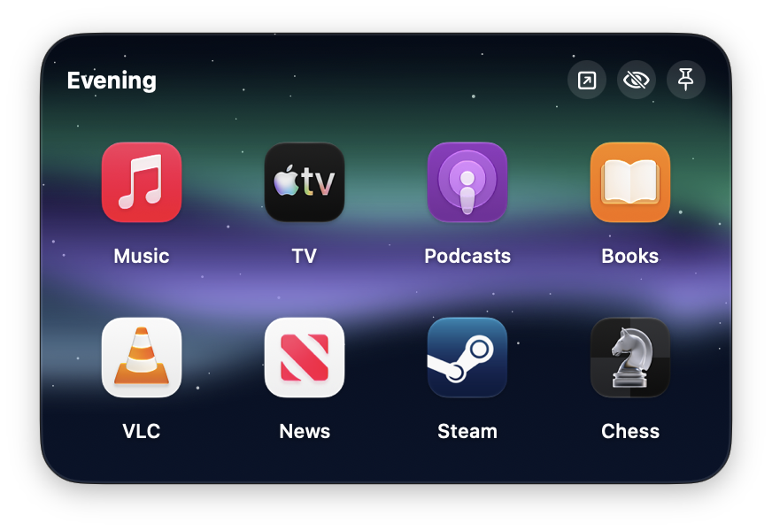

# Pocketwerk

Free, open-source app folders for the Mac Dock: each group of apps, files, folders and links gets its own Dock icon and opens right above it.



[Website](https://digitaliq.github.io/pocketwerk/) · [Download](https://github.com/DigitalIQ/pocketwerk/releases/latest) · [User guide](docs/USER_GUIDE.md) · [Changelog](CHANGELOG.md)

Pocketwerk runs on macOS 26 Tahoe and later, on Apple Silicon and Intel. The interface is in English and German. It is MIT licensed, has no account and sends no analytics.

## What it does

### Pockets in your Dock

A pocket (a group) holds apps, files, folders and links. Give it a Dock icon, and one click on that icon opens the pocket. A second click closes it. A Dock icon can also carry several groups; you swipe between them or pick them from a sidebar.

Drop files on a Dock icon to add them. Hold a drag over the icon and its popup opens, so you can drop right where you want. Pocketwerk's own Dock icon shows a live mini grid of your first group.

Smart groups fill themselves: Most Used, Recently Opened and Running Apps.

### Popup

The popup appears right above the Dock icon you clicked. It shows the group as a grid, a list or tiles, adapts its size to the content and pages through the rest.

- Folders open inside the popup. Space shows Quick Look.
- Keys 1 to 9 open the items of the current page. Hold ⌃ to see the numbers.
- Drag items in to add them, drag them within the popup to reorder, drag them out to use them elsewhere. Drop a file on an app to open it with that app.
- Open All, Hide All and Quit All work on the whole group. ⌥-click quits a single app. ⌘-click picks several items to open together.
- Type to search, use the arrow keys and Return, and swipe or scroll to the next page or group.
- Items whose app or file moved get a **Locate…** button.

### Assistant and suggestions

On Macs with Apple Intelligence, the **Assistant** tab changes a group from a plain sentence, for example "make it dark blue with a list view" or "add Pages and Numbers". It runs on your Mac. Every change is listed and can be undone; items are only removed after you confirm.

The App Drawer suggests apps that fit a group, and **Suggested Groups** proposes groups from apps you often use together. Without Apple Intelligence the suggestions come from app categories and your own usage, counted on this Mac only.

### Design Studio

Every group can look its own way. The Design Studio styles the popup with Liquid Glass, solid colors, gradients, photos, your blurred desktop picture, textures (optionally with falling snow) or animated backgrounds that react to the pointer. You set borders, fonts, labels, corner radius, glow, depth and the grid. Start from dozens of built-in themes and presets and save your own. Animated backgrounds pause when nobody can see them and slow down on battery.

The Dock icon is styled in the same place: a mini grid of the apps inside, a fanned stack, a folder shape, a symbol from an icon pack, an emoji, text or your own image. Pocketwerk's own app icon comes in five color variants.

### Dock profiles

Save the whole macOS Dock as a profile and switch between profiles with a hotkey, the menu bar, Shortcuts, Siri, a Focus, the command line or a URL. Profiles can:

- switch by themselves when you move to another Space or display,
- quit apps that are not part of them and launch the ones that are,
- open a project in an app or a browser in a given profile when applied,
- keep a short "where I left off" note that shows when you come back,
- take part in "next profile" cycling, or stay out of it,
- be exported and shared, unless you mark them private.

Custom spacers with text label parts of a long Dock.

### Keyboard and automation

Global hotkeys for every group, Dock icon and profile. ⌥⇧1 to ⌥⇧9 open the first nine groups out of the box. A hotkey can require a double or triple press or a follow-up key. A leader key works like a prefix: press it, then a letter. Rest the pointer in a hot corner to show all groups. None of this needs the Accessibility permission, and it works in full screen apps.

Shortcuts actions, Siri phrases, a `pocketwerk://` URL scheme and a command line tool cover the same actions for scripts. See [Automation](#automation).

Pocketwerk can live in the menu bar (in four icon styles), the Dock or both, and can start at login. A built-in help window (⌘?) works offline.

### Privacy

No account, no tracking, no analytics. Your groups live in one JSON file on your Mac. Pocketwerk goes online for two things only: a daily update check against the GitHub releases API and the favicons of your links. The assistant runs on device. Diagnostics are written to a local file only when you export them.

## Install

### Download the DMG

1. Download the latest DMG from [GitHub Releases](https://github.com/DigitalIQ/pocketwerk/releases/latest).
2. Open it and drag Pocketwerk into Applications.

### Homebrew

```bash
brew install --cask digitaliq/tap/pocketwerk
```

### First launch: "Open Anyway"

Pocketwerk is not notarized by Apple, so macOS blocks the first launch. You allow it once:

1. Open Pocketwerk. macOS says it cannot check the app for malicious software. Click **Done**.
2. Open **System Settings > Privacy & Security**.
3. Scroll down to the **Security** section. Next to the message that Pocketwerk was blocked, click **Open Anyway**.
4. macOS asks once more. Click **Open Anyway** and confirm with your password or Touch ID.

From then on Pocketwerk opens like any other app. On macOS 26, Control-click > Open in the Finder no longer skips this step; use System Settings.

### Why it is not notarized

Apple notarizes only apps signed with a Developer ID from the paid Apple Developer Program. Pocketwerk releases are signed ad hoc, so Gatekeeper cannot check them and asks you once. Every release is built from the tagged source in this repository with `scripts/release.sh`, so you can read the code or [build it yourself](#build-from-source).

## Quick start

1. Open Pocketwerk. The welcome window offers a few starter groups; take them or skip.
2. Create a group with **File > New Group** (⌘N) and give it a name.
3. Add items: **Add Apps** (⇧⌘A), **Add Files** (⇧⌘F), **Add Link** (⇧⌘L), or drag apps, files and folders onto the list.
4. Under **Dock Icons**, click **Add Slot**, choose the group and click **Add to Dock**. The Dock restarts once and shows the new icon.
5. Click the new Dock icon. The popup opens above it. Click again to close it.

The [user guide](docs/USER_GUIDE.md) explains everything else. Inside the app, **Help > Pocketwerk Help** (⌘?) has short topics.

## Automation

**Dock Profiles > Commands…** in the app lists every phrase, URL and command below with a Copy button.

### Shortcuts and Siri

Pocketwerk offers these actions in the Shortcuts app:

| Action | Siri phrase |
|---|---|
| Show Group | "Show *group* in Pocketwerk" |
| Open All Items of Group | "Open all of *group* in Pocketwerk" |
| Hide Apps of Group | |
| Quit Apps of Group | "Quit *group* in Pocketwerk" |
| Apply Dock Profile | "Switch Pocketwerk to *profile*" |
| Apply Next Dock Profile | "Next Dock profile in Pocketwerk" |

A Focus can apply a Dock profile too: add the **Set Dock Profile** filter to a Focus in System Settings > Focus.

The actions show up once macOS has indexed the app. Keep Pocketwerk in `/Applications` or `~/Applications` and open it once. If the actions are still missing, quit and relaunch Pocketwerk, or log out and in again. The `pocketwerk://` URLs below always work with the Shortcuts action "Open URLs".

### URL scheme

Open these URLs with `open "pocketwerk://..."`, from Shortcuts or from any app that opens links.

| URL | What it does |
|---|---|
| `pocketwerk://open` | Shows all groups |
| `pocketwerk://open?group=<name or id>` | Shows one group |
| `pocketwerk://open?slot=<id>` | Shows the groups of a Dock icon (slot) |
| `pocketwerk://group?action=openAll&name=<name>` | Opens every item of a group (`id=<id>` works too) |
| `pocketwerk://group?action=hideAll&name=<name>` | Hides the group's apps |
| `pocketwerk://group?action=quitAll&name=<name>` | Quits the group's apps |
| `pocketwerk://add?group=<id>&url=<url>` | Adds one or more items (repeat `url=`) to a group |
| `pocketwerk://add?slot=<id>&url=<url>` | Adds items to the first group of a Dock icon |
| `pocketwerk://settings` | Opens the settings |
| `pocketwerk://profile?name=<name>` | Applies a Dock profile (`id=<id>` works too) |
| `pocketwerk://profile?name=<name>&skip=1` | Applies a profile unless it is already active |
| `pocketwerk://profile?action=next` | Applies the next profile in the cycle |
| `pocketwerk://profile?action=capture&name=<name>` | Saves the current Dock as a new profile |
| `pocketwerk://profile?action=save` | Saves the current Dock into the active profile |

Group and profile names match exactly (case does not matter) or by a unique prefix. Values in a URL must be percent-encoded, for example `name=Deep%20Work`.

### Command line

The app binary has a command line mode. Run it directly:

```bash
/Applications/Pocketwerk.app/Contents/MacOS/Pocketwerk --cli help
```

or put [`scripts/pocketwerk`](scripts/pocketwerk) on your `PATH`. The wrapper finds the app in `/Applications`, `~/Applications` or `$POCKETWERK_APP`.

```text
pocketwerk profiles list                       List Dock profiles (* = active)
pocketwerk profiles apply <name|id> [--skip-if-active]
pocketwerk profiles capture <name>             Save the current Dock as a new profile
pocketwerk profiles save                       Save the current Dock into the active profile
pocketwerk profiles next                       Apply the next profile in the cycle
pocketwerk profiles export <file>              Write every non-private profile to a JSON file
pocketwerk profiles import <file>              Add the profiles from a JSON file
pocketwerk open <group name|id>                Show a group's popup
pocketwerk dock                                List the tiles in the current Dock
pocketwerk slots list                          List Dock slots and their launchers
pocketwerk slots install <name|id>             Build or update a slot's launcher
pocketwerk spaces                              Show the ids of the current Space and display
pocketwerk help
```

When the app is running, commands that change something are passed to it, so the running app stays the only writer of your data.

## FAQ

**Which permissions does Pocketwerk need?**
None. Hotkeys, the leader key and the hot corner work without Accessibility. The only optional prompt is Automation: when you use **Add Current Browser Tab**, macOS asks once whether Pocketwerk may read the front tab of Safari, Chrome, Arc or Brave. You can change that later in System Settings > Privacy & Security > Automation.

**Does the assistant send my data anywhere?**
No. It uses Apple's on-device model through Apple Intelligence. The conversation is forgotten when Pocketwerk quits. On Macs without Apple Intelligence the Assistant tab explains why it is unavailable, and suggestions fall back to app categories and your usage on this Mac.

**Does Pocketwerk change my Dock?**
Only when you ask it to: adding or removing a Pocketwerk icon, adding a spacer or applying a profile (by hand, by hotkey, or because you linked it to a Space or display). It writes the Dock preferences and restarts the Dock once, which takes a moment.

**What are the apps in `~/Applications/Pocketwerk`?**
Each Dock icon you create is a small launcher app. Its click tells Pocketwerk where to open the popup. Pocketwerk builds, updates and removes these launchers itself.

**My cleanup utility keeps quitting Pocketwerk.**
Some utilities quit apps that have no open windows. Pocketwerk usually has none and has to keep running for its Dock icons and hotkeys. Add Pocketwerk to that utility's exceptions.

**How do I uninstall it?**
1. In Pocketwerk, remove its icons from the Dock (**Dock Icons > Remove from Dock**), or drag them out of the Dock.
2. Turn off **Launch at login** in Settings > General, then quit Pocketwerk.
3. Delete `Pocketwerk.app` from Applications.
4. Delete the folder `~/Applications/Pocketwerk` (the Dock launchers).
5. Delete `~/Library/Application Support/Pocketwerk` (your groups, profiles, images and favicons). Export a backup first if you might come back.

With Homebrew, `brew uninstall --zap --cask pocketwerk` removes the app and both folders.

**How do I update?**
Pocketwerk checks GitHub once a day and shows a notice when a new version exists. Download the new DMG, or run `brew upgrade --cask pocketwerk`. Your Dock icons stay; Pocketwerk rebuilds their launchers by itself when a new version needs it.

**Something is not working. What should I send?**
Use **Help > Report a Problem…** to open the issue tracker. **Settings > Diagnostics > Export Diagnostics…** saves the last five hours of Pocketwerk's own log and a short summary as a text file. Nothing is sent automatically; look at the file before you attach it.

## Build from source

Requirements: macOS 26 and Xcode with the Swift 6.2 toolchain. There is no Xcode project; the app is built with SwiftPM.

```bash
export DEVELOPER_DIR=/Applications/Xcode.app/Contents/Developer
swift build                                  # debug build
swift test                                   # tests
UNIVERSAL=0 ./scripts/build-app.sh           # app bundle for this Mac only
./scripts/build-app.sh --install             # universal app, copied to ~/Applications
./scripts/build-app.sh --intents             # adds App Intents metadata for Shortcuts and Siri
```

The app bundle lands in `build/Pocketwerk.app`. [docs/ARCHITECTURE.md](docs/ARCHITECTURE.md) describes the targets, the data model and the modules.

## Contributing

Bug reports, ideas and pull requests are welcome. Read [CONTRIBUTING.md](CONTRIBUTING.md) first. Security issues go through [SECURITY.md](SECURITY.md).

## Support

If Pocketwerk is useful to you, you can [buy me a coffee](https://buymeacoffee.com/manuel_8472). Pocketwerk stays free either way.

## License

MIT. See [LICENSE](LICENSE). Made by DigitalIQ.
